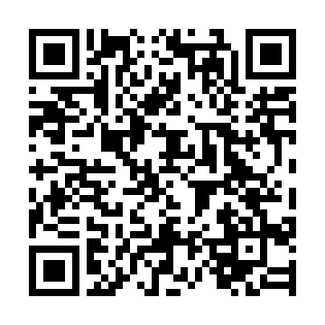

# Checkpoint 日本語版

3DS向け非公式版。日本語版：yu_

[CIA](https://github.com/Yu08083/Checkpoint-JP/releases/latest/download/Checkpoint.cia) · [3DSX](https://github.com/Yu08083/Checkpoint-JP/releases/latest/download/Checkpoint.3dsx)

FBIのQR読み取りでインストールできます。

英語で表示される場合は Settings → General → Language で「日本語」を選択してください。Automatic updates は無効にしてください。

原作者：[Bernardo Giordano・FlagBrew](https://github.com/BernardoGiordano/Checkpoint) および各貢献者。

[クレジット](README.upstream.md#credits) · [ライセンス](LICENSE) · [ビルド](BUILD.md)
